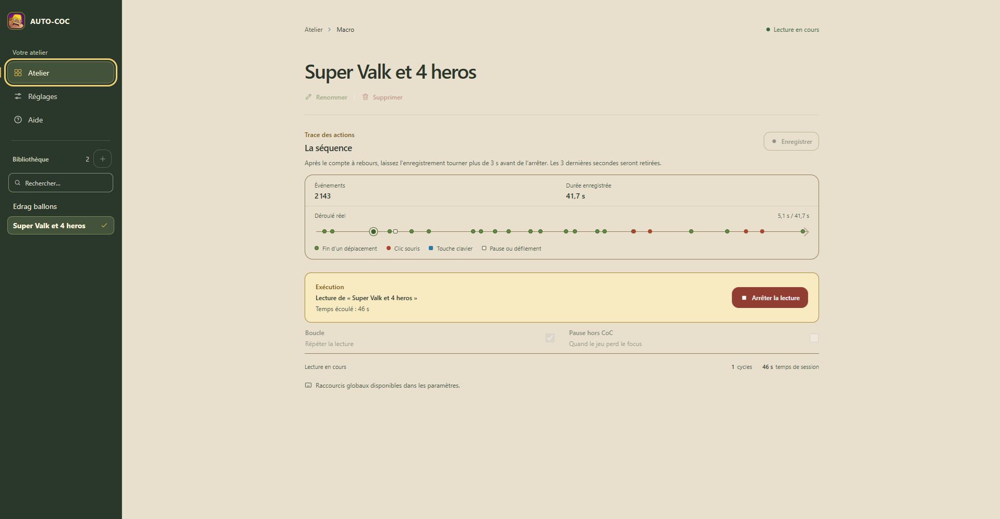

# 🎮 AUTO-COC v4.0

<p align="center">
  <strong>Enregistrez, organisez et rejouez vos macros dans Clash of Clans.</strong>
</p>

<p align="center">
  
  
  
  
</p>

<p align="center">
  
</p>

---

## 📋 Description

AUTO-COC est une application Windows pour enregistrer puis rejouer des actions clavier et souris dans Clash of Clans lancé avec Google Play Games. Les macros et les réglages restent sur l’ordinateur; Telegram permet, en option, de piloter quelques commandes à distance.

### ✨ Fonctions principales

| Fonctionnalité | Utilisation |
| --- | --- |
| 📝 Enregistrement | Capture une séquence après un compte à rebours de trois secondes. Les trois dernières secondes sont retirées à l’arrêt. |
| 🗂️ Bibliothèque | Créez, sélectionnez, renommez et supprimez vos macros depuis l’Atelier. |
| 🎯 Replay ciblé | Adresse les actions à la fenêtre reconnue de Clash of Clans; le mode arrière-plan se règle dans l’application. |
| 🔁 Boucle | Répète la macro jusqu’à l’arrêt. |
| ⌨️ Raccourcis | Personnalisez les commandes globales de lecture et d’arrêt. |
| 📲 Telegram | Lancez ou arrêtez une macro, sélectionnez une séquence et demandez une capture d’écran. |

## 🎮 Utilisation

1. Dans l’Atelier, créez ou sélectionnez une macro.
2. Ouvrez Clash of Clans au premier plan et démarrez l’enregistrement. Après les trois secondes de préparation, effectuez vos actions.
3. Arrêtez l’enregistrement, puis examinez le résumé et la trace avant de lancer la lecture.
4. Activez la boucle ou choisissez le comportement à la perte de focus directement dans l’Atelier ou dans Réglages.

### ⌨️ Raccourcis par défaut

| Raccourci | Action |
| --- | --- |
| `F1` | Basculer entre lecture et arrêt |
| `Ctrl+Shift+1` | Démarrer la lecture |
| `Ctrl+Shift+0` | Arrêter l’opération en cours |

Modifiez ces combinaisons dans **Réglages > Raccourcis**. Si Windows indique qu’une combinaison est déjà utilisée, choisissez-en une autre.

## ⚙️ Réglages et comportement

### Replay en arrière-plan

Le replay en arrière-plan est autorisé par défaut lorsqu’aucune valeur n’est enregistrée. Dans **Réglages**, l’option **Mettre en pause si CoC perd le focus** permet de choisir le comportement :

- Si elle est désactivée, AUTO-COC cible la fenêtre visible reconnue de Clash of Clans même lorsqu’une autre application est au premier plan. Le replay s’arrête si la fenêtre ou son processus disparaît; en cas de cible absente ou ambiguë, le démarrage échoue.
- Si elle est activée, une perte de focus met la lecture en pause. Un lancement depuis l’Atelier peut attendre jusqu’à 30 secondes que CoC passe au premier plan; les raccourcis et Telegram ne patientent pas.
- L’enregistrement reste toujours limité au premier plan et s’arrête si CoC perd le focus.

Le ciblage évite d’envoyer volontairement les entrées à l’application au premier plan, mais ne prouve pas que Google Play Games ou CoC traite chaque action. Un crash interne du jeu peut aussi passer inaperçu si la fenêtre hôte reste ouverte avec le même titre. Les nouvelles macros suivent la fenêtre de CoC lorsqu’elle bouge; les anciennes conservent leurs coordonnées écran. Les déplacements hors de la zone du jeu sont ignorés; un clic ou un défilement hors zone arrête le replay.

### 📲 Telegram et captures d’écran

Configurez un bot avec [@BotFather](https://t.me/BotFather), puis appairez une conversation privée dans **Réglages > Telegram**. Le bot permet notamment d’arrêter ou lancer la lecture et de choisir une macro. La commande `gif` n’est pas prise en charge.

Une capture depuis **Réglages > Système** ou Telegram tente de mettre CoC au premier plan avant de lire l’image de sa fenêtre. Windows peut refuser le changement de focus demandé à distance par Telegram; dans ce cas, aucune photo n’est envoyée et le bot demande de réessayer depuis le PC. Le token n’apparaît ni dans l’aide ni dans les diagnostics.

## 🚀 Installation et développement

### Prérequis Windows

- Windows 10 ou 11 x64.
- Rust avec le toolchain MSVC et les [Microsoft C++ Build Tools](https://visualstudio.microsoft.com/visual-cpp-build-tools/) (charge **Desktop development with C++** et Windows SDK). Au besoin : `rustup default stable-msvc`.
- Node.js `22.12+` et npm.
- Le runtime [Microsoft Edge WebView2 Evergreen](https://developer.microsoft.com/microsoft-edge/webview2/). Si nécessaire, l’installateur télécharge son bootstrapper et a besoin d’une connexion Internet.
- Le CLI Tauri 2, à installer une fois :

```powershell
cargo install tauri-cli --version "2.12.4" --locked
```

### Lancer l’application en développement

Depuis la racine du dépôt :

```powershell
cd frontend
npm ci
cargo tauri dev
```

La fenêtre Tauri charge Vite sur `127.0.0.1:5173`. Fermez la fenêtre ou faites `Ctrl+C` dans le terminal pour arrêter le mode développement.

## 🧪 Tests et validation

Depuis `frontend`, les contrôles de l’interface sont :

```powershell
npm run lint
npm run typecheck
npm test
npm run build
```

Depuis la racine, les vérifications Rust du backend sont :

```powershell
cargo fmt --manifest-path backend/Cargo.toml --check
cargo clippy --manifest-path backend/Cargo.toml --all-targets
cargo test --manifest-path backend/Cargo.toml
```

Le workflow [Windows desktop CI](.github/workflows/desktop.yml) exécute les contrôles frontend et Rust, construit l’installateur NSIS x64 et lance un smoke test de l’application installée. Celui-ci vérifie le lancement, quelques actions accessibles, la persistance d’une macro vide, la seconde instance et la fermeture.

Ces tests automatisés ne valident pas les pixels de l’interface, les raccourcis globaux réels, le traitement des clics par le jeu ni un bot Telegram en service. Avant distribution, vérifiez sur Windows l’enregistrement et le replay dans CoC, le mode arrière-plan et l’arrêt lorsque sa fenêtre disparaît, les raccourcis, Telegram et la capture d’écran. Un succès de `PostMessageW` signifie que Windows a accepté un message dans la file de la fenêtre ciblée; cela ne prouve pas que le jeu l’a traité.

## 📦 Construire et distribuer l’installateur

Depuis `frontend`, après installation des dépendances :

```powershell
cargo tauri build --bundles nsis --target x86_64-pc-windows-msvc
```

La configuration exécute aussi `npm run build`. L’installateur `*-setup.exe` est créé dans `frontend/src-tauri/target/x86_64-pc-windows-msvc/release/bundle/nsis/`. NSIS est utilisé ici même si la configuration Tauri propose aussi MSI.

Les installations NSIS utilisent le mode par utilisateur. AUTO-COC conserve ses données dans `%LOCALAPPDATA%\AUTO-COC`; le token Telegram est protégé pour le compte Windows courant. Les anciennes versions Python plaçaient leurs macros et réglages dans leur dossier `config/`; AUTO-COC v4 ne les importe pas automatiquement. Faites-en une copie avant de supprimer l’ancien projet.

### Générer et vérifier un installateur candidat

La version applicative est `4.0.0` dans `frontend/src-tauri/tauri.conf.json`, `frontend/src-tauri/Cargo.toml` et `backend/Cargo.toml`. Pour lancer le smoke test local, ouvrez une session Windows interactive avec un profil de test où `%LOCALAPPDATA%\com.autococ.desktop` n’existe pas, puis exécutez depuis la racine :

```powershell
$env:RUNNER_TEMP = $env:TEMP
.\.github\scripts\windows-runtime-smoke.ps1 -BundleDirectory .\frontend\src-tauri\target\x86_64-pc-windows-msvc\release\bundle\nsis
```

Le script installe le paquet dans un espace temporaire et tente de le désinstaller ensuite. Il refuse de démarrer si le profil Tauri existe déjà. Le smoke ne remplace pas les vérifications manuelles d’enregistrement, de replay et de raccourcis dans le jeu.

Le workflow conserve l’installateur comme artefact d’une pull request pendant 14 jours, selon les politiques GitHub du dépôt. Un push sur `main` construit et vérifie le paquet sans conserver d’artefact. Le workflow ne publie pas l’application et ne crée pas de GitHub Release.

Avant une distribution publique, mettez à jour ensemble les versions, configurez une signature Authenticode en gardant la clé privée hors du dépôt, et validez une procédure de publication qui attache l’installateur à une GitHub Release. Sans signature, Windows SmartScreen peut afficher un avertissement. L’updater Tauri n’est pas configuré.

## 📁 Structure du dépôt

```text
assets/                 capture de l’application utilisée dans ce README
backend/                logique métier Rust, stockage et accès Windows
frontend/src/           interface React et TypeScript
frontend/src-tauri/     fenêtre desktop, commandes et packaging Tauri
  icons/icon.ico        icône du paquet Windows
```
